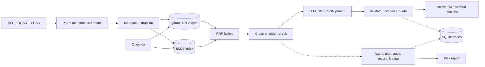

# ClauseCompass

Contract QA and compliance auditing where **every answer cites a source clause
that was verified in code** — not merely requested in a prompt.

530 real contracts · 18,280 clause chunks · 148-question golden eval set · runs
entirely on a laptop with local models.

**[Evaluation methodology](docs/EVAL.md)** · [build notes, day by day](notes/)

---

## Results

Every number below is reconstructable from a file in this repo. The ones that
look bad are the ones worth reading.

### Retrieval — ablation on the golden set

Document-scoped (the question names its contract, then retrieval is filtered to it):

| Configuration | recall@5 | recall@50 | MRR | nDCG@5 | p95 |
|---|---|---|---|---|---|
| Dense only (baseline) | 0.575 | 0.979 | 0.442 | 0.425 | 29 ms |
| BM25 only | 0.411 | 0.980 | 0.319 | 0.285 | 56 ms |
| Hybrid (RRF) | 0.481 | 0.987 | 0.394 | 0.356 | 87 ms |
| Hybrid + cross-encoder | 0.606 | 0.987 | 0.435 | 0.431 | 12.0 s |
| **+ entity-stripped rerank query** | **0.762** | 0.987 | **0.657** | **0.646** | 11.6 s |

**recall@5 0.575 → 0.762, MRR 0.442 → 0.657.**

Corpus-wide (search all 18,280 chunks), the same pipeline **did not help**:

| Configuration | recall@5 | recall@50 | MRR |
|---|---|---|---|
| **Dense only — still the winner** | **0.363** | 0.585 | **0.315** |
| Hybrid (RRF) | 0.338 | **0.604** | 0.276 |
| Hybrid + cross-encoder | 0.331 | 0.604 | 0.263 |

BM25 raised the *ceiling* (recall@50 0.585 → 0.604) but ranked noisily enough
that fusion lowered recall@5, and a cross-encoder cannot rank its way out of a
candidate pool that is only 60% correct. **That negative result names the binding
constraint:** corpus-wide, 40% of gold chunks are never retrieved at all.

### Reliability of generated answers

148 questions, `qwen2.5:3b` generating, `qwen2.5:7b` judging:

| Metric | Value |
|---|---|
| Deterministic validator fires | **64** (60 bad citations, 4 bad quotes) |
| Claims stripped before display | **64 of 191 (33%)** |
| Faithfulness (judge) | 0.493 |
| **Hallucination rate** | **0.507** |
| Judge agreement vs 40 hand labels | **95%** (1 lenient, 1 strict) |
| **Correct refusal** (18 unanswerable) | **1.00** |
| False answer rate | **0.00** |
| Over-refusal (130 answerable) | 0.469 |
| JSON parse failures | 0.007 |
| Cost per query | $0.00 (local) |

**Faithfulness 0.493 is a real number, not a broken judge** — that is what the
95% agreement check is for. A 3B model produces claims that quote correctly and
conclude wrongly.

### Agent

Policy: *"Every agreement must include a cap on liability."* 12 contracts, ground
truth from CUAD's attorney-reviewed annotations:

| Metric | Value |
|---|---|
| Clause-detection precision | **1.00** (fp = 0) |
| Clause-detection recall | **0.20** (fn = 4) |
| Finding attempts rejected by guardrails | **12 of 38 (31%)** — 6 for invented citations |
| Steps per contract / wall clock | 2.9 / 21.9 s |
| LLM share of wall clock | **93%** |
| Prompt-injection test | **PASS** |

---

## The three findings worth your 90 seconds

**1. Deterministic quote checking and semantic faithfulness are orthogonal.**
Every claim the judge rejected had *already passed* verbatim quote validation.
String matching catches fabricated citations (64 fires); it cannot catch a
correct quote followed by a wrong inference (61 claims). Reporting only the
deterministic number would have looked like a clean system.

**2. The same one-line change was worth +0.17 recall@5 in one scope and −0.17 in
the other.** The eval questions name the contract, but only 21% of gold clauses
contain that party name. Corpus-wide the cross-encoder needs the name to identify
the document; doc-scoped the filter already did that, so the name is noise
competing with clause semantics. Retrieval over a many-document corpus is two
problems — *which document* and *which clause* — and identity signals help the
first while hurting the second.

**3. The system's failures are all in the same direction, and it is the wrong
one.** Over-refusal 0.469, agent recall 0.20, correct-refusal 1.00. The 3B model
systematically under-asserts. For compliance that is backwards: a missed
violation is a lawsuit, a false positive is ten minutes of review. Day 5 measured
a 7B generator more than doubling faithfulness (0.414 → 0.885 on the overlapping
sample) — **model capacity, not prompt wording.**

---

## Why this isn't another "chat with your PDF"

- **Citations verified in code.** Every cited label must resolve to a retrieved
  chunk; every quote must match its source. Unverifiable claims are stripped
  before display — 33% of them were.
- **Refusal is measured, not assumed.** 12% of the eval set is deliberately
  unanswerable, with absence verified against the full contract text.
- **The eval set came first.** Days 4–6 each tested a prediction written down on
  Day 3. Two of those predictions were wrong, and the write-ups say so.
- **The agent cannot fabricate evidence.** A Pydantic `model_validator` makes a
  `compliant`/`violation` finding with no citations impossible to *construct*,
  and `record_finding` rejects citations that are not real chunk_ids.
- **Negative results are kept.** Hybrid retrieval didn't help corpus-wide; the
  Day 2 contextual prefix raises the similarity floor; BM25 lost on near-miss
  traps. All measured, all reported.

---

## Architecture



## Quickstart

```bash
git clone <repo> && cd clausecompass
make setup     # deps, Qdrant, pull qwen2.5:3b and 7b
make ingest    # CUAD + EDGAR -> chunks + metadata (~90 min)
make index     # embed + index (~5 min)
make eval      # reproduce the retrieval table (~2 min, no LLM)
make serve     # API on :8000  ->  http://localhost:8000/docs
make ui        # Streamlit on :8501
```

No API keys. Generation and judging run on local Ollama models.

## Stack

Python 3.11 · FastAPI · Qdrant · BGE-small embeddings + BGE reranker ·
rank_bm25 · Pydantic · SQLite tracing · Ollama · Docker · pytest

---

## Known limitations

Read these before reusing any number. Fuller treatment in
[docs/EVAL.md](docs/EVAL.md).

- **The eval set is AI-reviewed, not attorney-verified.** CUAD's clause spans are
  attorney-reviewed; the sampling review, the 30 hand-authored questions and the
  judge labels are mine. Each file records its provenance.
- **CUAD-shaped.** 118 of 148 questions come from CUAD's 41 annotation
  categories, so the set reflects what attorneys chose to annotate.
- **Questions name their contract.** An intervention: generic phrasing is
  byte-identical across all 530 contracts and scores hit@5 = 0/30.
- **Small samples where it matters.** near_miss n=6, multi_hop n=4, agent n=10.
  Directional only.
- **The agent scores clause detection on one policy**, not compliance judgement —
  CUAD records whether a clause exists, not whether it is adequate.
- **The injection test is confounded** by the agent's bias toward `silent`. The
  claim that holds unconditionally is the structural one, pinned by 6 tests.
- **The doc-scoped winner is not shippable at 11.6 s p95.** It needs a smaller
  cross-encoder or quantisation.
- **Docker is written but not built here** — 8 GB RAM at 92% swap. `docker
  compose config` validates; the image has not been assembled on this machine.
- **Concurrent `/ask` throughput is unverified.** `/audit` returning 202 with a
  job id proves background work does not block the response, but two simultaneous
  `/ask` calls could not be measured here — Ollama serialises requests to the
  same model, and the machine was paging too hard to get a clean number.
- **CI has never run.** No git remote existed when the workflow was written. It
  is wired to the real entrypoints and the real baseline, and runs on first push.
- **NER was never used.** The `dslim/bert-base-NER` and NLI weights would not
  download; party extraction and classification run through an LLM instead. Both
  backends are implemented; `metadata.json` records which produced each row.

## Repo map

| Path | What |
|---|---|
| `src/clausecompass/retrieval/` | `dense`, `sparse` (BM25), `fusion` (RRF), `rerank` |
| `src/clausecompass/generation/` | LLM provider + SQLite cache, cited-answer validation |
| `src/clausecompass/agent/` | schemas, 3 validated tools, planner + bounded loop |
| `src/clausecompass/eval/` | metrics, retrieval runner, generation runner |
| `src/clausecompass/obs/trace.py` | one-table span tracer |
| `src/clausecompass/api/main.py` | FastAPI: `/ask`, `/audit`, `/healthz`, `/metrics` |
| `evals/golden/golden.jsonl` | the 148-question eval set |
| `evals/baseline.json` | best-per-scope configuration |
| `runs/` | 31 recorded eval runs, each with a git SHA |
| `notes/day*-explained.md` | how each day's stack works, and every failure found |
| `docs/EVAL.md` | methodology, provenance, limitations |
