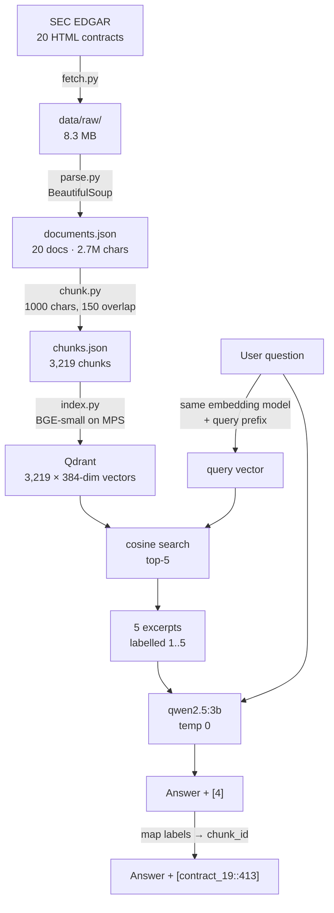

# ClauseCompass Day 1 — Explained From Scratch

A learning companion to the Day 1 build. Read top to bottom the first time.
Every number in here came from the actual run, not from a tutorial.

**How to use this for interviews:** the code is the easy part to talk about.
What earns you credit is Part 3 — a failure you found, how you isolated its
cause, and how you proved the fix. Most candidates cannot do that. You can.

---

## Contents

1. [Part 0 — The problem RAG solves](#part-0)
2. [Part 1 — The pipeline in one picture](#part-1)
3. [Part 2 — The five tasks, explained](#part-2)
4. [Part 3 — Failures, causes, fixes](#part-3)
5. [Part 4 — Glossary you must be able to say out loud](#part-4)
6. [Part 5 — Interview questions and answers](#part-5)
7. [Part 6 — Honest project status](#part-6)

---

<a name="part-0"></a>
## Part 0 — The problem RAG solves

You have 20 contracts. You want to ask *"What's the governing law?"* and get an
answer you can trust.

**Why not just paste the contracts into the LLM?**

The corpus is **2,728,031 characters** ≈ **680,000 tokens** (rough rule: ~4
characters per token for English). Three problems:

| Problem | Detail |
|---|---|
| Context window | Most models cap out well below 680k tokens. `qwen2.5:3b` declares 32k — and Ollama serves it at 2k by default (see F8). It physically doesn't fit. |
| Cost & latency | Even where it fits, you'd re-send 680k tokens on *every* question. |
| Attention dilution | Models get measurably worse at finding a fact buried in a huge context ("lost in the middle"). |

**Why not fine-tune a model on the contracts?**

Fine-tuning teaches *style and behaviour*, not reliable *fact lookup*. It can't
cite a source, you can't add a contract without retraining, and it will happily
invent plausible clauses. For "find me the exact clause and prove it," that's
the wrong tool.

**So: RAG — Retrieval-Augmented Generation.**

> Don't make the model *remember* the contracts. Make it *read* the three
> paragraphs that actually matter, and force it to cite them.

The insight: for any one question, almost all of those 680k tokens are
irrelevant. If you can find the ~5 relevant paragraphs, you've turned an
impossible problem into a 5,000-token one.

**The tradeoff you must be able to name:** RAG moves the hard problem from
generation to **retrieval**. If retrieval hands the model the wrong paragraphs,
a perfect LLM still gives a wrong answer. *Garbage in, confident garbage out.*
This is exactly what bit us — see F3.

---

<a name="part-1"></a>
## Part 1 — The pipeline in one picture



Two halves worth naming separately:

- **Indexing (offline, once):** fetch → parse → chunk → embed → store.
- **Querying (online, per question):** embed question → search → prompt → answer.

The embedding model appears in **both** halves, and it must be the *same model*
in both. Different models produce incompatible vector spaces — searching a
BGE index with an OpenAI query vector returns noise.

---

<a name="part-2"></a>
## Part 2 — The five tasks, explained

### Task 1 — Collect real contracts (`fetch.py`)

**What:** download 20 real Master Services Agreements from SEC EDGAR.

**Why real data matters:** synthetic contracts are clean, uniform, and short.
Real ones have running page headers, redaction markers (`[***]`), tables,
amendments that repeat clauses, and 460,000-character monsters. Every Day 1
failure came from a property of *real* documents. That's the point of the day.

**Why SEC EDGAR:** US public companies must file material contracts as
exhibits. It's free, public, and enormous.

**The exhibit-type trap.** Filings attach many documents. Only some are contracts:

| Type | What it is | Use? |
|---|---|---|
| `EX-10.1`, `EX-10.2`… | Material contract — the executed agreement | ✅ |
| `EX-99.x` | Press release announcing a deal | ❌ |
| `EX-101.x` | XBRL financial data | ❌ |
| `8-K`, `10-K` | The cover filing, not the contract | ❌ |

**How the automation works.** The search box at `sec.gov/edgar/search/` is a UI
over a JSON API at `efts.sec.gov/LATEST/search-index`. `fetch.py` calls it
directly, then applies four filters. The reject counts from the real run are the
interesting part:

| Filter | Rejected | Why it matters |
|---|---|---|
| `file_type` must match `EX-10.x` | **953** | Full-text search returns *whatever file contains the phrase* — mostly press releases and cover forms |
| One contract per filer (CIK) | **158** | Without this, one company dominates. Synacor appeared **6× in the first 19 hits** — the "20-contract corpus" would have been ~6 companies |
| Size 50 KB – 2 MB | **15** | Under 50 KB is usually a stub saying "incorporated by reference" |
| Must contain contract vocabulary | **4** | Cheap sanity check: `whereas`, `shall`, `agreement`, `section` |

**Concepts to know:**

- **CIK** — Central Index Key, SEC's unique company ID. Deduping on it is what
  buys corpus *diversity*. Sample diversity beats sample size.
- **Rate limiting / politeness** — SEC requires a `User-Agent` with contact info
  and allows ≤10 requests/sec. `fetch.py` sleeps 0.15 s between requests.
  Getting your IP banned mid-project is a real risk.
- **Reproducibility** — EDGAR relevance ranking drifts, so re-running `fetch.py`
  won't return identical files. That's why `data/raw/` is **committed to git**
  while `data/interim/` is gitignored: Day 3's evaluation set will reference
  exact `doc_id`s, and those must not move under it.

> **Interview line:** "I automated corpus collection and found that 83% of
> full-text search hits weren't contracts at all, and that without deduping by
> filer ID my 20-document corpus would have been six companies wearing twenty
> hats."

---

### Task 2 — Parse HTML to text (`parse.py`)

**What:** strip HTML markup, keep the words.

**How:** BeautifulSoup with the `lxml` parser.

```python
soup = BeautifulSoup(html, "lxml")
for tag in soup(["script", "style"]):
    tag.decompose()          # remove JS/CSS entirely - it is not contract text
text = soup.get_text("\n")   # extract text, newline between elements
text = text.replace("\xa0", " ")   # &nbsp; -> real space
text = "\n".join(l.strip() for l in text.split("\n") if l.strip())  # drop blank lines
```

**Why each line exists:**

- `decompose()` **deletes** the tag and contents. Without it, `get_text()` would
  return CSS rules and JavaScript as if they were clause text — which then get
  embedded and become retrievable garbage.
- `\xa0` is a non-breaking space. EDGAR filings are full of them. To Python it
  is *not* whitespace, so `.strip()` and `.split()` ignore it, and it survives
  into your embeddings as a weird token.
- Blank-line collapsing matters because EDGAR exhibits are laid out with
  **tables** for indentation. `get_text()` on a table emits a newline per cell,
  so raw output is mostly empty lines.

**Sanity check, and why it's non-negotiable:** the script flags any document
under 2,000 characters. A 300-character "parsed contract" means you saved the
wrong page or the parser ate everything. All 20 passed (13,206 – 460,219 chars).

**Concept — parser choice:** `lxml` is fast and lenient with the malformed HTML
that real filings contain. `html.parser` (stdlib) is slower and stricter;
`html5lib` is slowest but most browser-accurate. For messy filings, `lxml` is
the right default.

> **Interview line:** "Real filings use tables for layout, so naive text
> extraction produces more blank lines than content, and non-breaking spaces
> survive `.strip()` and pollute the embeddings."

---

### Task 3 — Chunking (`chunk.py`)

**What:** cut each document into 1,000-character pieces that overlap by 150.

**Why chunk at all?** Two independent reasons:

1. **Retrieval granularity.** One vector per *document* would be a 136,000-char
   average smeared into 384 numbers — a meaningless average of everything.
   Searching for "governing law" would match every contract equally.
2. **Context budget.** You can only fit a few thousand tokens into the prompt.
   The unit you retrieve must be small enough to send.

**Why overlap?** A clause split across a boundary would be crippled in both
pieces. Overlap means the boundary region appears *whole* in one of them.

**The stride, which is what actually determines chunk count:**

```
stride = CHUNK_SIZE - OVERLAP = 1000 - 150 = 850
```

Chunk *n* starts at character `n × 850`. Verified against the real run:

| | Value |
|---|---|
| Corpus | 2,728,031 chars |
| Predicted chunks (`chars / 850`) | ~3,209 |
| Actual chunks | **3,219** ✅ |
| Chunks at exactly 1000 chars | 3,197 (99%) — the rest are document tails |
| Stored text vs source text | 3,207,733 vs 2,728,031 = **17% inflation** |

That 17% is the **cost of overlap** — you store and embed 17% more text than
you have. It matches `150/850 = 17.6%`. Overlap is not free; it is a knob you
trade storage and near-duplicate retrieval against boundary safety.

**Chunks per document:** min 16, median 108, max 542. The spread mirrors real
contract length variation.

**What's wrong with this approach (deliberately):** character counting has no
idea what a sentence, clause, or section is. It cuts mid-word. This is a
**baseline to beat**, not a final design — Day 3 replaces it with *structural*
chunking that splits on section numbers like `7.2 Indemnification`. Keeping the
naive version is deliberate: you cannot claim an improvement without a baseline.

> **Interview line:** "Fixed-width chunking is a baseline. I kept it so Day 3's
> structural chunker has something to be measured against — the 17% storage
> overhead from overlap is the price of not splitting clauses, and it's a knob,
> not a constant."

---

### Task 4 — Embed and index (`index.py`)

This is the conceptual heart. Take it slowly.

#### What is an embedding?

A neural network that turns text into a fixed-length list of numbers — here
**384 floats**. It's trained so that **text with similar meaning lands at
nearby coordinates.**

Think of a map. "Cat" and "kitten" are neighbours; "cat" and "mortgage" are far
apart. An embedding is that map with 384 axes instead of 2. You never interpret
individual axes — only *distances between points*.

This is why RAG beats keyword search: a question about "ending the contract"
can retrieve a clause that says "termination for convenience" without sharing a
single word.

#### How is similarity measured?

**Cosine similarity** — the angle between two vectors, ignoring their length:

```
cos(A,B) = (A · B) / (|A| × |B|)
```

Range −1 to 1. For text embeddings you'll see roughly 0 to 1. Higher = more
similar. We ignore length because *direction* carries meaning while *magnitude*
mostly tracks text length, which we don't care about.

**Why `normalize_embeddings=True`:** it rescales every vector to length 1. Then
`|A| × |B| = 1`, so cosine similarity collapses to a plain dot product — faster,
and it means Qdrant's `Distance.COSINE` and the model agree exactly.

#### The model: `BAAI/bge-small-en-v1.5`

| Property | Value | Why it matters |
|---|---|---|
| Dimensions | 384 | Smaller = less storage, faster search, slightly less nuance |
| Size | ~130 MB | Runs locally, no API cost |
| Type | **Bi-encoder** | Encodes each text *independently* → precomputable |
| Quirk | Needs a **query prefix** | See below |

**`device="mps"`** — Metal Performance Shaders, Apple Silicon's GPU backend.
`cuda` is NVIDIA, `cpu` is the universal fallback. Encoding 3,219 chunks took
**32 seconds** on MPS.

#### The query-prefix asymmetry — a real gotcha

BGE was trained **asymmetrically**. Queries were prefixed during training;
documents were not:

```python
QUERY_PREFIX = "Represent this sentence for searching relevant passages: "
# queries:   model.encode(QUERY_PREFIX + question)   <- prefixed
# documents: model.encode(chunk_text)                <- NOT prefixed
```

The reason: a short question and a long passage are different kinds of text.
The prefix tells the model "this side is a search query, embed it into the space
where matching passages live."

**Why this is dangerous:** getting it wrong doesn't crash. It doesn't warn. You
silently lose 5–10% retrieval quality and never know. Class of bug worth naming
in an interview: **a silent correctness bug in a system with no ground truth**.
The only defence is an eval harness — which is why Day 3 is the most important
day.

#### The vector database: Qdrant

Storage for vectors plus fast nearest-neighbour search.

| Term | Meaning |
|---|---|
| **Collection** | A table. Ours is `clauses`. |
| **Point** | One row: an `id`, a `vector`, and a `payload`. |
| **Payload** | Arbitrary JSON attached to the vector — our `chunk_id`, `doc_id`, `text`. |
| **VectorParams** | Declares `size=384` and `distance=COSINE`. Must match your model. |
| **HNSW** | The index structure — a navigable graph enabling *approximate* nearest-neighbour search in ~log time instead of comparing all 3,219 vectors. |

**"Couldn't you just use NumPy?"** At 3,219 vectors, yes — brute force is
milliseconds. Be honest about that in an interview, then give the real reasons:
persistence across restarts, payload storage so retrieval returns the text
itself, **metadata filtering** (`doc_id`, and Day 2's extracted metadata), and
an approximate index that still works at 10 million chunks.

**Why the payload carries the full `text`:** so a search returns the actual
excerpt in one round trip. No second lookup into `chunks.json`, no risk of the
two drifting apart.

**One API note:** the tutorial's `client.recreate_collection()` and
`client.search()` are **deprecated** in `qdrant-client ≥1.19`. The code uses
`collection_exists` + `delete_collection` + `create_collection`, and
`query_points()`. Reading deprecation warnings instead of ignoring them is a
small habit interviewers notice.

**Verification instead of assumption:**

```python
count = client.count(COLLECTION, exact=True).count   # 3219 - matches chunks
```

Don't print "Indexed 3219 chunks" from `len(chunks)`. Ask the database what it
actually holds. Those two numbers disagreeing is exactly the bug you want to
catch.

> **Interview line:** "An embedding maps text to a point in 384-dimensional
> space where distance approximates semantic similarity. BGE is asymmetric —
> queries need a prefix, documents don't — and omitting it degrades retrieval
> silently, with no error, which is why the eval harness matters more than any
> single component."

---

### Task 5 — Retrieve and generate (`ask.py`)

Five steps:

```python
qv = model.encode(QUERY_PREFIX + question, normalize_embeddings=True)   # 1 embed
hits = client.query_points("clauses", query=qv.tolist(), limit=5).points # 2 search
context = "\n\n".join(f"[{label}]\n{h.payload['text']}" for ...)         # 3 build
resp = httpx.post(OLLAMA_URL, json={...})                               # 4 generate
print(restore_chunk_ids(answer, label_to_chunk))                        # 5 map back
```

**`limit=5` (top-k) is a real tradeoff:**

| k too small | k too large |
|---|---|
| The answer isn't in the context — unrecoverable | Dilutes attention, costs tokens, invites blending unrelated sources |

**The prompt does three jobs:**

```
Answer the question using ONLY the excerpts below.       <- grounding
Cite the excerpt label after every factual statement.    <- traceability
If the excerpts don't contain the answer, say            <- refusal path
"Not found in the provided excerpts."
```

1. **Grounding** — "ONLY the excerpts" fights the model's urge to answer from
   parametric memory.
2. **Citations** — makes the answer *checkable*. An uncheckable answer is
   worthless in a legal setting.
3. **A refusal path** — without an explicit escape hatch, models invent
   something. Giving refusal a name makes it reachable. Day 5 scores this as
   **refusal accuracy**.

**`temperature: 0.0`** — always pick the highest-probability token. Makes runs
deterministic, so when you change one thing you can attribute the difference to
that change. Creativity is not a feature here.

**Why labels are `[1]`…`[5]` and not `[contract_19::413]`** — this is the Day 1
headline failure. See F1.

---

<a name="part-3"></a>
## Part 3 — Failures, causes, fixes

This is your interview material. For each: symptom → cause → evidence → fix.

### F1 — The model invented citation IDs ✅ FIXED

**Symptom.** Asked *"What is the governing law?"* and got:

```
[Governing Law::27] The construction, performance and validity of this
Agreement shall be governed by the laws of the jurisdiction where the
Premises are located.
```

`Governing Law::27` **does not exist**. The answer looked authoritative and was
untraceable — the worst combination.

**Cause: a format collision.** I asked for IDs shaped `name::number`. The
retrieved chunk `contract_12::202` contains the literal heading
`27.15 Governing Law` — shaped `number name`. The model pattern-matched onto the
*contract's own section numbering* instead of my chunk IDs.

**Evidence — one controlled experiment.** Same question, same five retrieved
chunks, temperature 0. Only the labels changed:

| Labels | Model cited | Valid? |
|---|---|---|
| `[contract_09::8]`… | `[Governing Law::27]` | ✗ fabricated |
| `[1]`…`[5]` | `[4]` | ✓ correct chunk |

Holding retrieval fixed is what makes this a *diagnosis* rather than a guess.

**Fix.** Label excerpts `[1]`…`[k]` in the prompt; map back to `chunk_id`
afterwards. The model never sees an ID that resembles contract text.

```python
label_to_chunk = {str(i): h.payload["chunk_id"] for i, h in enumerate(hits, 1)}
# ... generate ...
answer = restore_chunk_ids(answer, label_to_chunk)   # [4] -> [contract_19::413]
```

**The twist, and the better story.** My first fix *made things worse*. I added
prohibitions — "do not invent labels", "do not cite section numbers" — and got
`[Governing Law]` and `[jurisdiction where the Premises are located]`. A third
variant said "never put words inside brackets" and produced `[27.15]`: obeying
the letter while still citing a section number.

So I A/B'd three prompts across all four stock questions:

| Prompt variant | Has valid citation | **Fabricated a label** |
|---|---|---|
| **Minimal** — `Cite the excerpt label ... like [3].` | 3/4 | **0/4** ✅ |
| + prohibitions | 3/4 | 1/4 |
| + enumerated labels, "never put words in brackets" | 2/4 | 1/4 |

**Negative instructions steered the small model toward the forbidden content.**
Minimal shipped. Fabricated citations: **0/4**.

> **Interview line:** "I fixed a hallucinated-citation bug by changing the label
> format, then discovered my own fix had regressed because I'd added
> prohibitions to the prompt — and on a 3B model, naming the forbidden thing
> made it more likely. I A/B'd three prompt variants and shipped the minimal
> one at zero fabrications. The lesson was that I only caught my regression
> because I'd built output validation at the same time as the fix."

---

### F2 — A sentence spliced from two different contracts ✅ FIXED (same root cause)

**Symptom.** That same answer quoted a sentence existing **nowhere** in the corpus:

- `"construction, performance and validity of this agreement"` → **contract_12** only
- `"where the premises are located"` → **contract_19** only

Healthways welded to Goodman Networks. Grammatical, legally-shaped, and
completely fabricated.

**I first logged this as the most dangerous, separate failure. It wasn't.** Under
opaque labels the splice vanished — the model quoted contract_19 alone and cited
it correctly. Once the citation was anchored to a real chunk, the *text* stayed
anchored too. **One root cause, two symptoms.**

That correction is itself worth telling: distinguishing a root cause from a
downstream symptom removed an entire item from the fix list.

**Lesson that survives for Day 3:** faithfulness **cannot** be scored by keyword
overlap — both halves of that sentence overlap the corpus perfectly. It needs
span-level attribution against the *single cited chunk*.

---

### F3 — Similarity scores cannot express relevance ⚠️ OPEN → Day 4

**Symptom.** Top-5 scores are almost identical. For "termination provisions":
0.7717 → 0.7677 across five *different companies*. A 0.004 spread. No threshold
can separate good from bad.

**Cause — measured, not guessed.** I embedded 300 random chunks and computed all
44,850 pairwise similarities to find the corpus's own similarity floor:

| Measurement | Cosine |
|---|---|
| Random chunk pair, mean | 0.6430 |
| Random chunk pair, p90 | 0.7060 |
| Random chunk pair, **p99** | **0.7787** |
| **Real query, top-1** (governing law) | **0.7670** |
| Nonsense query top-1 (`banana bicycle photosynthesis`) | 0.5779 |

**Read that carefully: the best relevant chunk scores *below* the 99th
percentile of two randomly chosen chunks.**

The embedding space is **compressed** because every chunk is the same register —
contract boilerplate. In this corpus, 0.77 doesn't mean "relevant." It means
"is legalese." (The general phenomenon is **anisotropy**: embeddings occupy a
narrow cone rather than spreading over the space.)

**The useful split** — the score is not useless, it's useless *for one thing*:

- ✅ It **can** detect an off-topic question: 0.578 vs 0.767 is a real gap.
- ❌ It **cannot** rank clause relevance, and must **not** drive abstention.
  Any threshold separating 0.767 from 0.779 is fitting noise.

**Fix (Day 4): a cross-encoder re-ranker.** The distinction matters:

| | Bi-encoder (BGE-small, used now) | Cross-encoder (Day 4) |
|---|---|---|
| Input | Query and chunk **separately** | Query and chunk **together** |
| Output | Two vectors, compared after | A single relevance score |
| Precomputable? | Yes — embed the corpus once | No — must run per query-chunk pair |
| Speed | Milliseconds over millions | ~50–100 pairs per query, realistically |
| Accuracy | Good | Much better |

Standard pattern: bi-encoder retrieves top-50 cheaply, cross-encoder rescores
those 50 and keeps the best 5. You get cross-encoder precision at bi-encoder
scale.

> **Interview line:** "My retrieval scores looked healthy at 0.77 until I
> measured the corpus's own similarity floor: random chunk pairs averaged 0.64
> and reached 0.78 at p99, so my best relevant chunk was scoring below the noise
> ceiling. In a domain-uniform corpus, absolute cosine similarity measures
> register, not relevance — which makes a cross-encoder re-ranker mandatory
> rather than an optimisation."

---

### F4 — Citations sometimes missing entirely ⚠️ OPEN → Day 5

**Symptom.** "What are the termination provisions?" returns a well-grounded
answer with **zero** `[...]` citations.

**Cause (hypothesis, not confirmed).** Instruction-following variance in a 3B
model. Distinct from F1 — here it *omits* rather than *invents*.

**Current state:** detected, not prevented. `ask.py` validates every emitted
citation against the retrieved label set and warns:

```
WARNING: answer contains no valid citation.
```

**Why detection first is the right call:** it's the safe failure direction. A
missing citation is visibly incomplete; a *fabricated* one is invisible.
It also caught my own F1 regression — the value of validation showed up
immediately.

**Fix (Day 5):** retry once, then refuse. And score two separate metrics,
because they have different causes:

- **Citation presence** — did it cite at all?
- **Citation correctness** — does the cited chunk support the claim?

---

### F5 — Retrieval wastes slots on near-duplicates ⚠️ OPEN → Day 4

**Symptom.** Governing-law top-5 returned 5 chunks from only 3 documents —
contract_09 twice, contract_12 twice.

**My first hypothesis was wrong, and the correction is the interesting bit.** I
assumed standard MSA boilerplate repeating *across* filers. Measured it: of
sampled pairs above 0.95 similarity, **0 were cross-contract and 3 were
within-contract.** The redundancy is *internal* to each document:

| Pair | Sim | What it actually is |
|---|---|---|
| `contract_10::157` vs `::191` | 0.9900 | Same entire-agreement clause, repeated by amendments |
| `contract_19::395` vs `::458` | 0.9430 | SEC confidential-treatment legend on every page |
| `contract_15::445` vs `::0` | 0.9132 | Running header `Sabre – MSA Exhibit 10.103 EXECUTION VERSION` |

Note the last two: **running headers are embedded inside otherwise-useful
chunks**, inflating similarity between unrelated parts of the same document.
That makes header stripping a *retrieval* fix, not a cosmetic one.

**Fix (Day 4):** cap slots per `doc_id`, or use **MMR** (Maximal Marginal
Relevance — select each next result for relevance *minus* similarity to what's
already selected). Strip repeated page headers in the parser.

---

### F6 — The question presupposes one document; the corpus has 20 ⚠️ OPEN — product decision

All five stock questions say "**this** agreement." Retrieval spans 20 unrelated
MSAs, so a blended answer is the honest output of a badly-posed question.

**Not a bug — a scoping decision** you must make before Day 3, because the
golden eval set can't be written until you do:

- **Option A:** filter by `doc_id` first — "governing law *of contract_04*". The
  payload filter is already indexed.
- **Option B:** keep it cross-corpus and group findings per contract — "12 of 20
  contracts specify New York law." A more interesting product.

Recognising that a bad answer came from a bad *question* is a senior instinct.

---

### F7 — Chunks cut mid-clause ⚠️ OPEN → Day 3

**Symptom.** `contract_09::8` opens *"possession, directly or indirectly, of the
power to direct..."* — the definition began in chunk 7, so this chunk can't
stand alone as evidence.

I hit this again while verifying a citation: `contract_07::52` looked off-topic
in preview (software transition text) but actually contains
`20. LIMITATION OF LIABILITY / In no event shall either party be liable...`
a third of the way in. The chunk was correct; the *boundary* made it look wrong.

**Cause.** 1,000-character windows have no notion of sentence, clause, or section.

**Fix (Day 3):** structural chunking on section numbers (`7.2 Indemnification`),
so a chunk is a *clause* rather than an arbitrary window.

---

### F8 — Ollama silently discarded 60% of the prompt ✅ FIXED

Found while fact-checking this document, which is a lesson in itself.

**Symptom.** I claimed in Part 0 that `qwen2.5:3b` handles ~32k tokens. Checking
it, the model does declare `context_length = 32768`. But measuring what Ollama
*actually evaluated* gave nonsense:

| top_k | Prompt size | Tokens actually evaluated |
|---|---|---|
| 5 | 5,215 chars | 1,201 |
| 10 | 10,246 chars | 2,304 |
| 20 | 20,316 chars | **2,050** ← *fewer than top_k=10* |

Twice the text, fewer tokens processed. Something was throwing text away.

**Cause.** **Ollama defaults `num_ctx` to 2048 tokens regardless of what the
model supports, and truncates an over-long prompt silently** — no error, no
warning, no field in the response saying it happened.

Confirmed by setting it explicitly on the identical prompt:

| Setting | Tokens evaluated (of ~5,079 expected) |
|---|---|
| `num_ctx` default | 2,050 — **60% of excerpts discarded** |
| `num_ctx=8192` | 4,479 — full prompt |

**Why this was a landmine rather than an active bug.** At `TOP_K=5` the prompt
is ~1,200 tokens, under the 2,048 cap, so Day 1 answers were unaffected. But
there was **no margin**: raising top-k, lengthening chunks, or adding a
system prompt would silently degrade answers while every log line looked
healthy. The model would appear to "miss" clauses it was never shown.

**Fix.** Set `num_ctx` explicitly and warn when the prompt approaches it:

```python
NUM_CTX = 8192
# ...
"options": {"temperature": 0.0, "num_ctx": NUM_CTX},
# ...
used = body.get("prompt_eval_count")
if used and used >= NUM_CTX * 0.9:
    print(f"WARNING: prompt used {used}/{NUM_CTX} context tokens ...")
```

**The transferable lesson.** Every inference runtime has defaults that don't
match the model's capability. Never assume the model saw what you sent — check
`prompt_eval_count` against your own token estimate. This is the same failure
class as the BGE query prefix: **silently wrong, never loud.**

> **Interview line:** "I found that Ollama caps context at 2048 tokens by
> default and truncates over-long prompts with no error — at 20 retrieved
> chunks, 60% of my excerpts never reached the model. It wasn't affecting my
> answers yet because top-5 fit under the cap, but it would have silently
> sabotaged every retrieval improvement I made afterwards. I now set num_ctx
> explicitly and assert the evaluated token count against my own estimate."

---

### What is measurably **not** a problem

Don't waste Day 4 here. Over all 3,219 chunks:

| Check | Result |
|---|---|
| Table-of-contents / dot-leader chunks | **0** |
| Exact-duplicate chunk texts | **0** |
| Chunks under 75% alphabetic | 9 |
| Chunks under 300 chars | 4 |

The parser isn't producing garbage. Every real failure is in retrieval or
generation. **Knowing where *not* to optimise is worth as much as knowing where to.**

---

<a name="part-4"></a>
## Part 4 — Glossary you must be able to say out loud

| Term | One-sentence definition |
|---|---|
| **RAG** | Retrieve relevant passages, put them in the prompt, generate a grounded answer. |
| **Embedding** | A fixed-length vector where distance approximates semantic similarity. |
| **Cosine similarity** | Angle between two vectors, ignoring magnitude; higher = more similar. |
| **Normalisation** | Scaling vectors to length 1 so cosine similarity equals a dot product. |
| **Bi-encoder** | Encodes query and document separately — precomputable, fast, less accurate. |
| **Cross-encoder** | Encodes query and document together — not precomputable, slow, much more accurate. |
| **Re-ranking** | Cheap retrieval of top-50, then expensive rescoring down to top-5. |
| **Chunking** | Splitting documents into retrievable units. |
| **Overlap / stride** | Shared text between adjacent chunks; `stride = size − overlap`. |
| **Top-k** | How many chunks to retrieve and put in the prompt. |
| **ANN / HNSW** | Approximate nearest-neighbour search via a navigable graph, sub-linear in corpus size. |
| **Payload** | Metadata stored alongside a vector (our `chunk_id`, `doc_id`, `text`). |
| **Grounding** | Requiring the answer to come only from retrieved context. |
| **Faithfulness** | Whether the answer is actually supported by the cited source. |
| **Hallucination** | Fluent output not supported by any source. |
| **Refusal accuracy** | How reliably the system says "not found" when the answer genuinely isn't there. |
| **Anisotropy** | Embeddings clustering in a narrow cone, compressing the usable score range. |
| **MMR** | Maximal Marginal Relevance — pick results for relevance *minus* redundancy. |
| **Temperature** | Sampling randomness; 0 = deterministic. |
| **Context window / `num_ctx`** | Max tokens a model can attend to at once; the *runtime's* default may be far below the model's capability. |
| **`prompt_eval_count`** | Tokens the runtime actually processed — compare against your estimate to detect truncation. |
| **Recall@k** | Fraction of questions whose correct chunk appears in the top k. |
| **MRR** | Mean Reciprocal Rank — 1/(rank of first correct result), averaged. |

---

<a name="part-5"></a>
## Part 5 — Interview questions and answers

**"Walk me through your project."**
> ClauseCompass answers questions about real commercial contracts with citations
> you can verify. I collected 20 Master Services Agreements from SEC EDGAR,
> parsed them out of HTML, chunked them, embedded them with BGE-small, indexed
> 3,219 vectors in Qdrant, and generate answers with a local model constrained
> to cite its sources. Day 1 was a deliberately rough walking skeleton — the
> point was to prove every piece connects, then measure where it fails.

**"Why RAG and not fine-tuning?"**
> Fine-tuning teaches style, not verifiable fact lookup. It can't cite a source,
> can't add a contract without retraining, and will invent plausible clauses.
> For "find the clause and prove it," retrieval is the right tool. RAG also
> moves the hard problem to retrieval — if I retrieve the wrong paragraphs, a
> perfect LLM still answers wrongly, which is exactly what I measured.

**"How do you know it works?"**
> On Day 1 I don't, and that's the honest answer — I hand-verified individual
> citations against the chunk store, which catches egregious failures but
> doesn't measure quality. That's why Day 3 is a golden eval set and a harness.
> Without ground truth, the silent failures win: I found a hallucinated citation
> only because I checked a chunk ID by hand.

**"What was the hardest bug?"**
> A fabricated citation. The model emitted `[Governing Law::27]`, which doesn't
> exist, wrapping a sentence spliced from two different contracts. The cause was
> a format collision — my IDs were `name::number` and the contract's own
> headings were `number name`, so it pattern-matched the wrong thing. I isolated
> it by holding retrieval fixed and changing only the labels. Then my first fix
> regressed, because I'd added prohibitions to the prompt and on a 3B model
> naming the forbidden thing made it more likely. I A/B'd three variants and
> shipped the minimal prompt at zero fabrications out of four.

**"Your retrieval scores are 0.77 — is that good?"**
> That's the trap I fell into. I measured the corpus's own floor: random chunk
> pairs average 0.643 and hit 0.779 at p99, so my best relevant chunk was
> scoring below the noise ceiling. In a domain-uniform corpus, absolute cosine
> similarity measures register, not relevance. It's still useful for detecting
> off-topic queries — nonsense scored 0.578 — but it can't rank relevance or
> drive abstention. Hence a cross-encoder re-ranker.

**"Why Qdrant and not NumPy?"**
> At 3,219 vectors, brute force would genuinely be fine, and I'd say so.
> Qdrant buys persistence, payload storage so retrieval returns the text
> itself, metadata filtering for per-document scoping, and an approximate index
> that still works at millions of chunks.

**"What would you do differently?"**
> Build the eval harness before the retrieval improvements. Every Day 1 bug was
> silent — no crash, no warning — and I found them by hand-checking. That
> doesn't scale, and it means I can't tell whether a change helped. I'd also
> validate model output from the very first version; my citation validator
> caught my own regression within minutes.

**"How would you scale this to a million contracts?"**
> Indexing is embarrassingly parallel. HNSW handles the search side. The real
> pressures are re-ranking cost (bounded by only rescoring top-50), embedding
> throughput (batch on GPU), and metadata filtering becoming essential rather
> than optional. And evaluation gets harder, not easier — a golden set of 50
> questions says little about a million-document corpus.

---

<a name="part-6"></a>
## Part 6 — Honest project status

Do **not** claim the whole pipeline is solved. Interviewers probe, and a
precise account of what's open reads as competence. State it like this:

| # | Failure | Status |
|---|---|---|
| F1 | Fabricated citation IDs | ✅ **Fixed** — opaque labels, 0/4 fabrications, validated in code |
| F2 | Cross-contract sentence splice | ✅ **Fixed** — was a symptom of F1 |
| F3 | Scores can't express relevance | ⚠️ Diagnosed & quantified → cross-encoder, Day 4 |
| F4 | Citations sometimes missing | ⚠️ **Detected** (warns), enforcement Day 5 |
| F5 | Near-duplicates waste top-k | ⚠️ Diagnosed → per-doc cap + header stripping |
| F6 | Single-doc question, 20-doc corpus | ⚠️ Open **product decision**, blocks Day 3 |
| F7 | Chunks cut mid-clause | ⚠️ Known → structural chunking, Day 3 |
| F8 | Ollama truncated 60% of the prompt silently | ✅ **Fixed** — `num_ctx` set explicitly + truncation guard |

**The framing that sells this:** Day 1 wasn't supposed to produce a good system.
It was supposed to produce a *working* system and an *evidence-based* list of
what to fix. It did both — and three of the eight items turned out to be misdiagnosed or
invisible on first pass, which is why measuring beat guessing.
